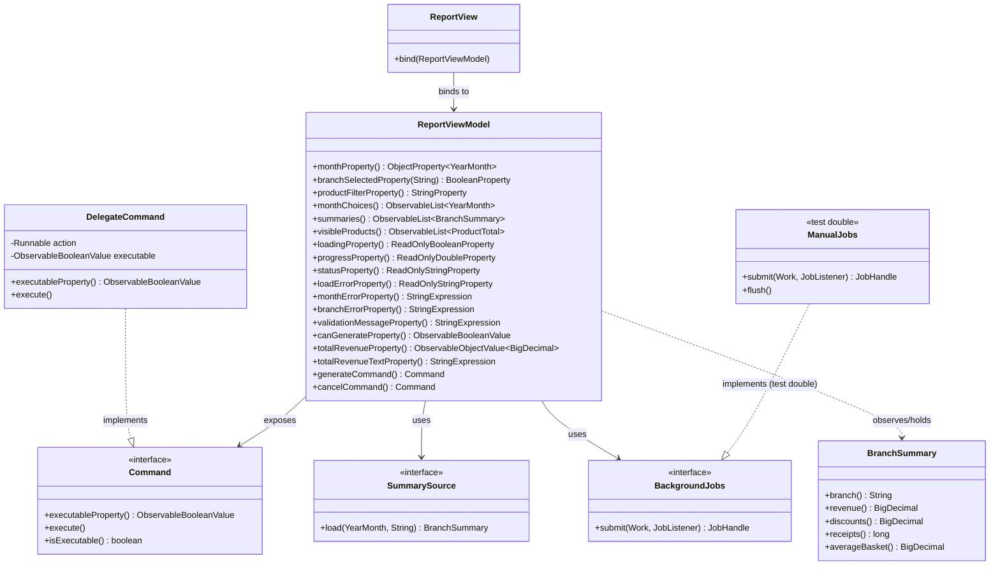
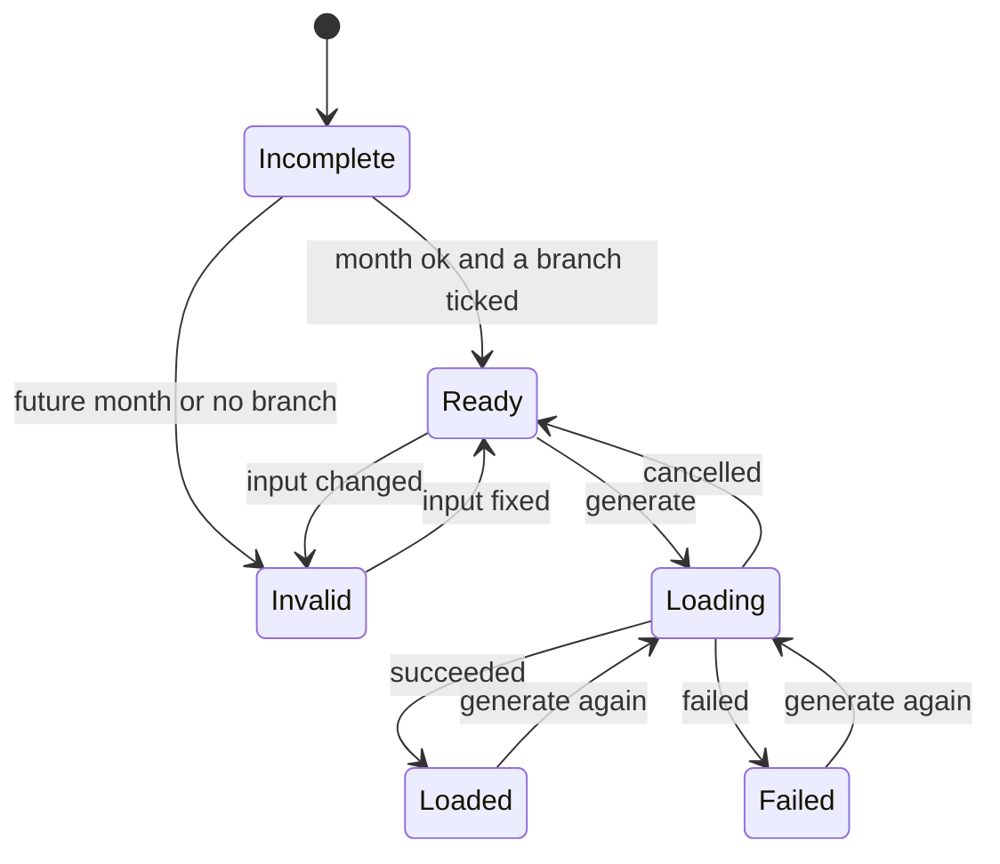

# Task 1: ViewModel Design

## 1. Controller Inventory (Lab-02 Refactoring)

The following table analyzes the responsibilities, control reads/writes, and branching conditions from the Lab-02 controller/screen architecture and assigns each to its new owner (Model, ViewModel, or View) under MVVM:

| Code / Action | Concern | New Owner |
| :--- | :--- | :--- |
| `monthField.getText()` / `monthBox.getValue()` | Reads the selected/entered month from the UI control | **View** (two-way bound to `ViewModel.monthProperty()`) |
| `InputRules.month(text, clock)` / `isAfter(now)` | Validates the month format and ensures it is not in the future | **ViewModel** (computed binding `monthErrorProperty()`) |
| `branchBox.getValue()` / `branchCheckBox.isSelected()` | Reads user branch selections from the UI controls | **View** (bound to `ViewModel.branchSelectedProperty(branch)`) |
| `selectedBranches().isEmpty()` | Validates that at least one branch is selected | **ViewModel** (computed binding `branchErrorProperty()`) |
| `productFilterField.getText()` | Reads search filter string for product name and SKU | **View** (two-way bound to `ViewModel.productFilterProperty()`) |
| `generateButton.setDisable(!valid || loading)` | Controls whether user can trigger data generation | **ViewModel** (`canGenerateProperty()` / `generateCommand.executableProperty()`) |
| `cancelButton.setDisable(!loading)` | Controls whether user can cancel a running load job | **ViewModel** (`cancelCommand.executableProperty()`) |
| `model.load(dataDir, month)` / CSV parsing & aggregation | Reads CSV files and computes branch summaries and product totals | **Model** (accessed via `SummarySource` port) |
| Threading / offloading CSV processing off UI thread | Prevents blocking the JavaFX Application Thread during data load | **Infrastructure/Model** (orchestrated via `BackgroundJobs` port) |
| `statusLabel.setText(...)` | Displays operational progress, instructions, and outcomes | **View** (one-way bound to `ViewModel.statusProperty()`) |
| `progressBar.setProgress(...)` | Displays load progress fraction | **View** (one-way bound to `ViewModel.progressProperty()`) |
| `errorLabel.setText(error)` | Displays validation error or file load error message | **View** (bound to `validationMessageProperty()` & `loadErrorProperty()`) |
| `tableView.setItems(...)` | Renders branch summaries and filtered products list | **View** (bound to `ViewModel.summaries()` & `visibleProducts()`) |
| `totalRevenueLabel.setText("USD " + ...)` | Formats and displays aggregated revenue | **ViewModel** calculates formatted string (`totalRevenueTextProperty()`), **View** displays it |

---

## 2. ViewModel Members Specification

The members of `ReportViewModel` are structured into three distinct categories plus commands, enforcing clear unidirectional or bidirectional data flow:

### 2.1 Input State (Two-Way Bound by View)
State that originates from user actions and is bound bidirectionally to view controls:

| Member | Type | View May Write? | Description |
| :--- | :--- | :---: | :--- |
| `month` | `ObjectProperty<YearMonth>` | **Yes** | Selected month from combo box or text input |
| `branchSelected(b)` | `BooleanProperty` | **Yes** | Selection state for branch `b` (`PNH`, `REP`, `BTB`) |
| `productFilter` | `StringProperty` | **Yes** | Filter text for product name and SKU matching |

### 2.2 Output State (One-Way Bound by View)
State produced by the model or ViewModel that the View observes and renders:

| Member | Exposed Type | View May Write? | Description |
| :--- | :--- | :---: | :--- |
| `monthChoices` | `ObservableList<YearMonth>` | **No** (Unmodifiable) | List of the last 12 selectable months |
| `summaries` | `ObservableList<BranchSummary>` | **No** (Unmodifiable) | Loaded branch summary rows for the table |
| `visibleProducts` | `FilteredList<ProductTotal>` | **No** (Read-Only) | Filtered top-products list |
| `loading` | `ReadOnlyBooleanProperty` | **No** | True while background job is executing |
| `progress` | `ReadOnlyDoubleProperty` | **No** | Progress indicator value between 0.0 and 1.0 |
| `status` | `ReadOnlyStringProperty` | **No** | Status line message |
| `loadError` | `ReadOnlyStringProperty` | **No** | Error message when loading data fails |

### 2.3 Computed State (Read-Only Derived Bindings)
Values computed automatically via reactive bindings from input and output states:

| Member | Exposed Type | View May Write? | Description |
| :--- | :--- | :---: | :--- |
| `monthError` | `StringExpression` | **No** | Validation message if month is empty or in the future |
| `branchError` | `StringExpression` | **No** | Validation message if no branch is selected |
| `validationMessage`| `StringExpression` | **No** | Aggregate validation message for display |
| `canGenerate` | `ObservableBooleanValue` | **No** | True when month is valid, >= 1 branch selected, and not loading |
| `totalRevenue` | `ObservableObjectValue<BigDecimal>` | **No** | Sum of revenue across all loaded branch summaries |
| `totalRevenueText` | `StringExpression` | **No** | Formatted chain total revenue string (e.g., `USD 12,345.60`) |

### 2.4 Commands
Actions exposed to the View wrapped in `Command` objects with executable guards:

| Command | Executable Condition | View May Write? | Description |
| :--- | :--- | :---: | :--- |
| `generateCommand` | `canGenerate` | **No** (Trigger only) | Initiates background report generation |
| `cancelCommand` | `loading` | **No** (Trigger only) | Cancels the currently running background job |

---

## 3. Architecture & Class Diagram
The ViewModel depends only on abstract ports (`SummarySource`, `BackgroundJobs`), the domain model (`BranchSummary`), and `javafx.base` observable properties. It has zero coupling to JavaFX UI controls (`javafx.scene.*`).

---

## 4. Screen State Machine

### Property Values per State

| State | `month` | `branchSelected` | `monthError` | `branchError` | `validationMessage` | `canGenerate` | `loading` | `status` | `loadError` | Data Content |
| :--- | :--- | :--- | :--- | :--- | :--- | :---: | :---: | :--- | :--- | :--- |
| **Incomplete** | `null` (or empty) | $\ge 1$ selected | `"Choose a month."` | `""` | `"Choose a month."` | `false` | `false` | `"Choose a month."` | `""` | `summaries` and `products` empty |
| **Invalid** | Future month (e.g. `2026-10`) OR empty branches | None selected OR valid | `"Month ... is in the future."` or `""` | `"Select at least one branch."` or `""` | Non-empty error message(s) | `false` | `false` | Previous status | `""` | Previous data unchanged |
| **Ready** | Valid month $\le$ current month | $\ge 1$ selected | `""` | `""` | `""` | `true` | `false` | Initial / Previous status | `""` | Previous data unchanged |
| **Loading** | Valid month | $\ge 1$ selected | `""` | `""` | `""` | `false` | `true` | `"Loading X branch(es)..."` | `""` | Previous data |
| **Loaded** | Valid month | $\ge 1$ selected | `""` | `""` | `""` | `true` | `false` | `"Loaded 3 branch(es) for 2026-08."` | `""` | Updated `summaries` and merged `products` |
| **Failed** | Valid month | $\ge 1$ selected | `""` | `""` | `""` | `true` | `false` | `"Load failed, previous data kept."` | Exception message (e.g. `"...: unreadable"`) | Previous `summaries` and `products` kept |
